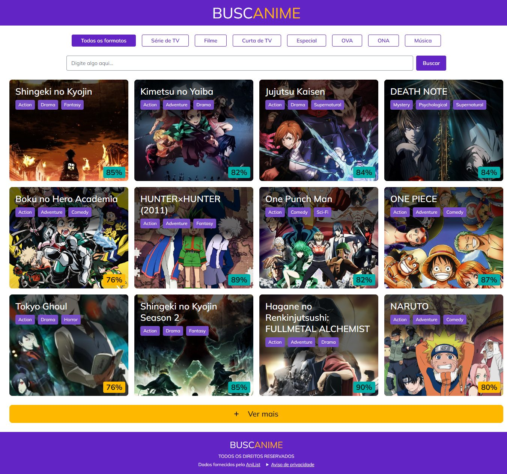
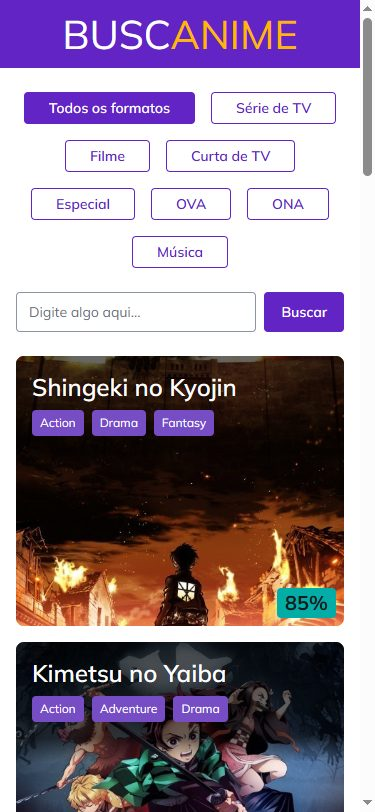

# BuscAnime

Catálogo web de animes com dados da API AniList, com filtro por formato, busca por texto e nota destacada por cor.

Em produção: <https://anime-list-silk.vercel.app/>. Para entender o código em 10 minutos, comece pelo [passo a passo técnico](docs/walkthrough.md).





## Entrega do desafio

| Requisito do desafio | Onde está |
| --- | --- |
| React e TypeScript, com dados da AniList | React 19 com Vite e TypeScript estrito; consulta GraphQL em [`fetchAnimeCatalog.ts`](src/features/anime-catalog/api/fetchAnimeCatalog.ts) |
| Filtrar por formato | Botões em [`FormatFilter.tsx`](src/features/anime-catalog/components/FormatFilter.tsx), com o estado na URL (`?format=MOVIE`) |
| Buscar por texto | Campo em [`SearchForm.tsx`](src/features/anime-catalog/components/SearchForm.tsx), enviado com Enter ou "Buscar" (`?q=naruto`) |
| Nota por cor: abaixo de 50 vermelho, de 50 a 80 amarelo, acima de 80 verde | [`scoreTone.ts`](src/features/anime-catalog/model/scoreTone.ts), com teste nos limites 49, 50, 80 e 81; nota nula mostra "Sem nota" |
| Seguir o Figma | Layout, cores, tipografia e proporções do frame, medidos lado a lado. Os rótulos dos filtros estão em português, e as cores de texto de baixo contraste foram corrigidas; todos os desvios estão em [Desvios do design](docs/decisions/000-pre-development.md#desvios-do-design) |
| Como usou IA | [AI_LOG.md](AI_LOG.md) e [CLAUDE.md](CLAUDE.md) |
| Decisões, trade-offs e o que faria com mais tempo | [DECISIONS.md](DECISIONS.md) |
| Publicação | Vercel, no link acima |

## Estado atual

O catálogo mostra os animes mais populares da AniList, 12 por vez, em cards com capa, título, até 3 gêneros e nota por cor, com skeleton durante o carregamento. Cada card abre a página do anime na AniList em nova aba. O filtro por formato e a busca por texto ficam na URL (`?format=MOVIE&q=naruto`), e "Ver mais" acrescenta mais 12 animes à lista. Erro, 429, timeout de 10s, lista vazia e falha de renderização têm mensagem e botão próprios.

Além do pedido: acessibilidade WCAG 2.2 AA verificada com axe, sem rolagem horizontal de 320px a 1920px, cabeçalhos de segurança com CSP restrita, ícones e prévia do link, aviso de privacidade e atribuição à AniList.

Fora do escopo, com o motivo e o que ficou para depois: [DECISIONS.md](DECISIONS.md#o-que-faria-com-mais-tempo).

## Tecnologias

React 19, Vite 8, TypeScript estrito, Tailwind 4, TanStack Query, Zod (`zod/mini`), Vitest com Testing Library e MSW, Playwright com axe, ESLint, Prettier, Lefthook e commitlint. Os motivos de cada escolha estão em [DECISIONS.md](DECISIONS.md).

## Como executar

Requer Node 24.22.2, versão fixada em [`.nvmrc`](.nvmrc).

```bash
nvm use
npm ci
npm run hooks:install
npx playwright install chromium
npm run dev
```

- `npm run hooks:install` ativa os hooks do Git apenas neste repositório. Veja [Git](docs/conventions/git.md).
- `npx playwright install chromium` baixa o navegador usado em `npm run test:e2e`.
- `npm run build` gera o build de produção, e `npm run preview` o serve.

Só para rodar o app, bastam `npm ci` e `npm run dev`.

## Como testar

```bash
npm run verify
```

Roda, na ordem do merge: lint, typecheck, testes, build, limite de tamanho e testes de interface. Os testes das regras de lint rodam pelo hook de commit quando a configuração do ESLint muda. Cada etapa também roda separada:

| Comando | O que faz |
| --- | --- |
| `npm run lint` | ESLint em `src` e `e2e` |
| `npm run typecheck` | TypeScript estrito |
| `npm test` | Vitest com Testing Library e MSW |
| `npm run test:contract` | Consulta a API real com o schema; fica fora do `verify` e exige rede |
| `npm run test:guards` | Prova de que cada regra de lint reprova o que deve |
| `npm run build` | Build de produção |
| `npm run size` | Limite de 100 KB gzip de JS inicial; rode o build antes |
| `npm run test:e2e` | Playwright em Chromium com axe; as capturas ficam em `test-results/layout/` |
| `npm run format:check` | Prettier, sem alterar arquivos |

Detalhes em [Testes](docs/conventions/testing.md). Não há GitHub Actions: as verificações rodam nos hooks locais, e o motivo está em [DECISIONS.md](DECISIONS.md#o-que-faria-com-mais-tempo).

## Documentação

[Arquitetura](docs/architecture.md), [convenções de código](docs/conventions/code.md), [acessibilidade](docs/conventions/accessibility.md), [segurança](docs/conventions/security.md), [tokens](docs/design/tokens.md), [API AniList](docs/api/anilist.md), [decisões e trade-offs](DECISIONS.md) e [uso de IA](AI_LOG.md).

## Linha do tempo

Cada linha corresponde a uma branch integrada à `main`. As 10 primeiras são as previstas na [spec da fundação](docs/specs/000-foundation/spec.md#ordem-das-branches); a 11ª foi aberta depois, a partir de um levantamento de código e de fidelidade ao design, e a 12ª corrige problemas relatados no uso.

| # | Branch | Entrega | Referência |
| --- | --- | --- | --- |
| 1 | `docs/pre-development-decisions` | Levantamento de design, API e obrigações legais; medições; decisões técnicas; spec da fundação | [Decisões](docs/decisions/000-pre-development.md) |
| 2 | `chore/project-foundation` | Instalação limpa, regras automáticas, tokens, layout base e documentação | [Spec](docs/specs/000-foundation/spec.md) |
| 3 | `feat/anime-catalog` | Cliente GraphQL, catálogo em cards, nota por cor, skeleton e teste de contrato | [Spec](docs/specs/001-anime-catalog/spec.md) |
| 4 | `feat/format-filter` | Filtro por formato em botões, com estado na URL | [Spec](docs/specs/002-catalog-discovery/spec.md#featformat-filter) |
| 5 | `feat/text-search` | Busca por texto enviada ao confirmar, ordenada por relevância e combinada com o filtro | [Spec](docs/specs/002-catalog-discovery/spec.md#feattext-search) |
| 6 | `feat/load-more` | "Ver mais" com skeleton, erro sem perder a lista e aviso para leitores de tela | [Spec](docs/specs/002-catalog-discovery/spec.md#featload-more) |
| 7 | `feat/feedback-states` | Timeout de 10s, nova tentativa, mensagem para o limite de requisições, lista vazia com limpeza de filtros e error boundary | [Spec](docs/specs/003-feedback-and-security/spec.md#featfeedback-states) |
| 8 | `chore/security-headers` | CSP sem `unsafe-inline`, cabeçalhos no `vercel.json`, capas só de `s4.anilist.co` e teste da CSP no navegador | [Spec](docs/specs/003-feedback-and-security/spec.md#choresecurity-headers) |
| 9 | `feat/product-polish` | Ícone da aba e do iPhone, prévia do link com a marca, meta tags e `robots.txt` | [Spec](docs/specs/004-polish-and-walkthrough/spec.md#featproduct-polish) |
| 10 | `docs/technical-walkthrough` | Passo a passo técnico para quem avalia o código, com teste dos links | [Passo a passo](docs/walkthrough.md) |
| 11 | `feat/final-polish` | Cards que abrem a AniList, movimento ao passar o mouse, foco mantido na busca, título da aba, limite de busca, cache dos assets, cor da capa como fundo, layout alinhado ao Figma e licença MIT | [Spec](docs/specs/005-final-polish/spec.md) |
| 12 | `fix/search-and-load-feedback` | Busca sem espaços repetidos, lista vazia que explica a busca por palavras completas e fim do aviso de carregamento que piscava no `npm run dev` | [Spec](docs/specs/006-search-feedback/spec.md) |

O que ficou de fora está em [O que faria com mais tempo](DECISIONS.md#o-que-faria-com-mais-tempo).
